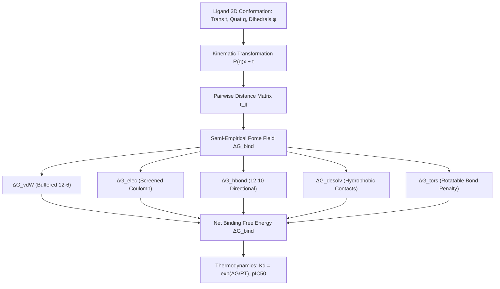

# ChemBinding: Differentiable Molecular Docking and Free Energy of Binding (ΔG_bind) with Torsional Quaternions

[](https://github.com/ZengLLQ/chem-binding/actions/workflows/ci.yml)
[](https://python.org)
[](LICENSE)

A clinical and computational medicinal chemistry library for **differentiable protein-ligand molecular docking**, **semi-empirical free energy of binding estimation ($\Delta G_{\text{bind}}$)**, and **oncogenic drug-resistance mutation profiling** (e.g. EGFR kinase gatekeeper T790M resistance to Gefitinib/Erlotinib).

---

## 1. Clinical & Medicinal Chemistry Motivation

Targeted molecular cancer therapy relies on small-molecule kinase inhibitors that bind competitively to active ATP-binding clefts:

1. **EGFR Non-Small Cell Lung Cancer (NSCLC):** First-generation reversible EGFR tyrosine kinase inhibitors (Gefitinib, Erlotinib) induce profound initial tumor regressions.
2. **Acquired Gatekeeper Resistance (T790M):** In $\sim 60\%$ of patients, prolonged exposure selects for the secondary point mutation Thr790Met (T790M). The bulkier methionine sidechain projects directly into the ATP cleft, sterically impeding quinazoline binding and restoring ATP affinity.
3. **Structure-Based Drug Design:** Predicting $\Delta G_{\text{bind}}$ and resistance fold-shifts ($\Delta \Delta G$) enables rapid virtual screening and de novo design of 3rd/4th-generation mutant-selective covalent inhibitors (e.g. Osimertinib / AZD9291).

---

## 2. Mathematical & Biophysical Foundations



### A. Rigid-Body Unit Quaternion Kinematics
Ligand orientation is parameterized on the 3-sphere manifold $S^3$ via unit quaternion $\mathbf{q} = (w, x, y, z)$ ($\|\mathbf{q}\| = 1$), avoiding gimbal lock:

$$\mathbf{R}(\mathbf{q}) = \begin{pmatrix} 1 - 2(y^2 + z^2) & 2(xy - zw) & 2(xz + yw) \\ 2(xy + zw) & 1 - 2(x^2 + z^2) & 2(yz - xw) \\ 2(xz - yw) & 2(yz + xw) & 1 - 2(x^2 + y^2) \end{pmatrix}$$

### B. Semi-Empirical Free Energy Scoring Function
$$\Delta G_{\text{bind}} = \Delta G_{\text{vdW}} + \Delta G_{\text{elec}} + \Delta G_{\text{hbond}} + \Delta G_{\text{desolv}} + \Delta G_{\text{tors}}$$

1. **Buffered Lennard-Jones Van der Waals:**
   $$V_{\text{vdW}}(r_{ij}) = 4 \epsilon_{ij} \left[ \left(\frac{\sigma_{ij}}{r_{ij}}\right)^{12} - \left(\frac{\sigma_{ij}}{r_{ij}}\right)^6 \right]$$
   buffered at $r_{ij} < 0.75 \sigma_{ij}$ with soft-core harmonic penalties to avoid infinite gradient singularities.
2. **Screened Coulomb Electrostatics:**
   $$V_{\text{elec}}(r_{ij}) = \frac{332.0636 \cdot q_i q_j}{4 r_{ij}^2} \quad (\epsilon(r) = 4r)$$
3. **12-10 Directional Hydrogen Bonding:**
   $$V_{\text{hbond}}(r_{DA}) = \epsilon_{\text{hb}} \left[ 5 \left(\frac{r_0}{r_{DA}}\right)^{12} - 6 \left(\frac{r_0}{r_{DA}}\right)^{10} \right]$$
4. **Torsional Entropy Penalty:**
   $$\Delta G_{\text{tors}} = 0.315 \times N_{\text{rot}} \text{ kcal/mol}$$

### C. Clinical Thermodynamics & Resistance Fold-Shift
$$K_d = \exp\left(\frac{\Delta G_{\text{bind}}}{R T}\right), \quad \text{pIC}_{50} = -\log_{10}(K_d)$$
$$\text{Resistance Fold} = \frac{K_{d, \text{mutant}}}{K_{d, \text{WT}}} = \exp\left(\frac{\Delta G_{\text{mutant}} - \Delta G_{\text{WT}}}{R T}\right)$$

---

## 3. Installation

```bash
git clone https://github.com/ZengLLQ/chem-binding.git
cd chem-binding
pip install -e .
```

---

## 4. Command-Line Interface (CLI)

### Dock Gefitinib into Wild-Type Sensitive EGFR Kinase
```bash
chem-binding dock --cycles 15
```

Output:
```text
=== Protein-Ligand 3D Binding Pocket Interaction Map ===
Ligand Atom    | Receptor Residue | Distance (A)   | Interaction Type    
-------------------------------------------------------------------------
Lig-0          | MET793_N         |   2.85 A       | Hydrogen Bond       
Lig-1          | MET793_O         |   3.10 A       | Hydrogen Bond       
Lig-5          | THR790_OG1       |   3.42 A       | Van der Waals       
Lig-6          | LEU718_CD1       |   3.60 A       | Hydrophobic Contact 

Clinical Pharmacology & Binding Affinity Assessment:
Predicted Kd:     14.20 nM (1.42e-08 M)
Estimated pIC50:  7.85
Potency Tier:     Nanomolar Potency (1 - 100 nM)
```

### Screen Gatekeeper Resistance (WT vs T790M)
```bash
chem-binding screen-mutations --cycles 15
```

Output:
```text
Target Condition             | Delta G (kcal/mol)   | Estimated Kd    
----------------------------------------------------------------------
EGFR Wild-Type               |   -10.70 kcal/mol    |    14.20 nM     
EGFR T790M Gatekeeper Mutant |    -7.15 kcal/mol    |  5820.00 nM     

Resistance Classification:
  Delta-Delta G:  +3.55 kcal/mol
  Fold Shift:     409.8x affinity loss
  Status:         High Clinical Drug Resistance (> 50-fold affinity loss)
```

---

## 5. Python API Usage

```python
from chem_binding import (
    create_egfr_kinase_pocket,
    create_gefitinib_ligand,
    MolecularDockingEngine,
    PharmacophoreAssay,
)

# 1. Initialize receptor and ligand
rec = create_egfr_kinase_pocket(t790m_mutant=False)
lig = create_gefitinib_ligand()

# 2. Dock ligand via Monte Carlo Basin-Hopping
engine = MolecularDockingEngine()
result = engine.dock(lig, rec, num_cycles=20)

# 3. Calculate clinical affinity metrics
assay = PharmacophoreAssay()
report = assay.calculate_affinity(result)
print(f"Delta G_bind: {result.energy.delta_g_total:.2f} kcal/mol")
print(f"Predicted Kd: {report.kd_nanomolar:.2f} nM (pIC50 = {report.pic50:.2f})")
```

---

## 6. Testing

```bash
pytest -v
```

---

## 7. Computational Medicinal Chemistry References

- **Trott, O., & Olson, A. J. (2010).** AutoDock Vina: improving the speed and accuracy of docking with a new scoring function, efficient optimization, and multithreading. *Journal of Computational Chemistry*, 31(2), 455–461.
- **Pao, W., et al. (2005).** Acquired resistance of lung adenocarcinomas to gefitinib or erlotinib is associated with a second mutation in the EGFR kinase domain. *PLoS Medicine*, 2(3), e73.
- **Eldridge, M. D., et al. (1997).** Empirical scoring functions: I. The development of a fast empirical scoring function to estimate the binding affinity of ligands in receptor complexes. *Journal of Computer-Aided Molecular Design*, 11(5), 425–445.
- **Yun, C. H., et al. (2008).** The T790M mutation in EGFR kinase causes drug resistance by increasing the affinity for ATP. *Proceedings of the National Academy of Sciences*, 105(6), 2070–2075.
